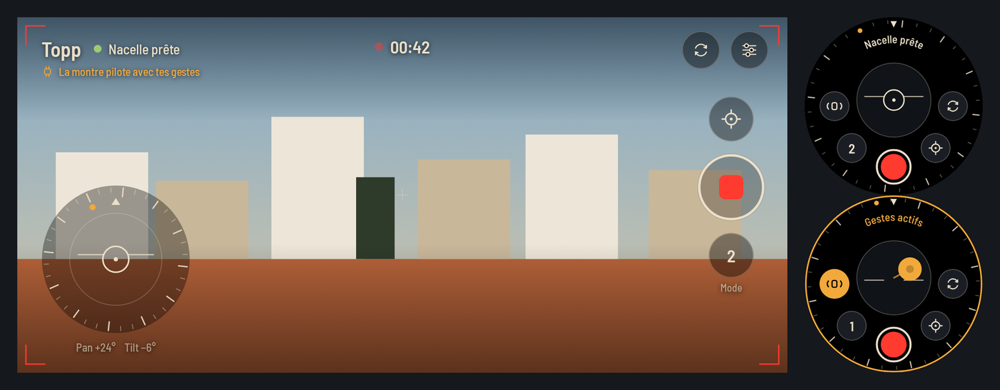
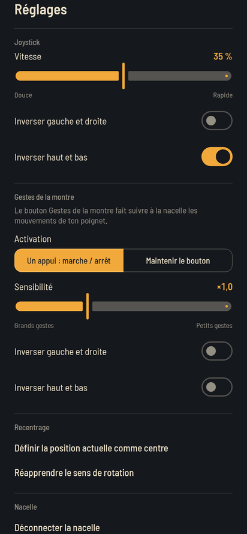

# Topp

Pilote la nacelle **Hohem iSteady V3** depuis ta **Galaxy Watch**, sans l'appli Hohem Joy.
*Topp* veut dire « suivre » en wolof.



## Ce que fait Topp

**Sur le téléphone** (posé sur la nacelle)
- Affiche l'image de la caméra comme un viseur de tournage et filme en Full HD. Les vidéos arrivent dans Films/Topp.
- Le joystick est un cadran : sa graduation tourne avec l'angle réel de la nacelle, la ligne d'horizon suit l'inclinaison, et un point ambre marque la position de repos.
- Change le mode de la nacelle, la recentre, passe d'une caméra à l'autre.
- Le déclencheur de la nacelle lance et arrête l'enregistrement.

**Sur la montre**
- Un joystick tactile pour orienter la nacelle.
- Les boutons Filmer, Mode, Recentrer et Changer de caméra.
- **Les gestes du poignet** : touche le bouton Gestes et la nacelle suit ta main. Pointe la main à gauche ou à droite pour tourner, lève ou baisse les doigts pour incliner. Plus tu t'écartes du point de départ, plus elle va vite.
- Un anneau rouge autour de l'écran pendant l'enregistrement, ambre quand les gestes sont actifs.

Dans les réglages du téléphone, tu choisis comment s'activent les gestes (un appui pour marche/arrêt, ou seulement tant que tu maintiens le bouton), leur sensibilité et leur sens.



## Installer

Télécharge les deux fichiers de la [dernière version](https://github.com/fpapef/topp/releases/latest).

**Téléphone :** ouvre `Topp-telephone-x.y.apk` et accepte l'installation d'applis de source inconnue. Au premier lancement, autorise « Appareils à proximité », la caméra et le micro.

**Montre :** elle s'installe depuis un PC avec les [Android Platform-Tools](https://developer.android.com/tools/releases/platform-tools).
1. Sur la montre : Paramètres → À propos de la montre → Informations sur le logiciel, touche 5 fois « Version du logiciel ».
2. Dans Options de développement, active « Débogage ADB » puis « Débogage sans fil » (montre et PC sur le même Wi-Fi).
3. « Associer un nouvel appareil », puis sur le PC : `.\adb pair IP:port` et le code affiché.
4. Avec l'adresse de l'écran principal du débogage sans fil : `.\adb connect IP:port`, puis `.\adb install -r Topp-montre-x.y.apk`.

Si adb répond « more than one device », ajoute `-s IP:port` juste après `.\adb`.

## Premier essai

1. Ferme complètement Hohem Joy (Forcer l'arrêt), sinon elle garde la nacelle pour elle.
2. Éteins le module de suivi IA aimanté de la nacelle.
3. Ouvre Topp sur le téléphone : « Nacelle prête » s'affiche en quelques secondes. Sinon, touche « Choisir la nacelle » et sélectionne-la dans la liste.
4. Ouvre Topp sur la montre.

Si un sens est inversé, coche « Inverser » dans les réglages (joystick et gestes ont leurs propres réglages). Le recentrage apprend le sens de rotation de la nacelle la première fois, avec une petite poussée d'essai.

## Comment ça marche

Hohem ne publie pas le protocole Bluetooth de ses nacelles. Il a été déduit des journaux de l'appli Hohem Joy, puis vérifié : Topp reproduit octet par octet les 1 312 commandes de suivi capturées.

Quand Hohem Joy suit un sujet, elle envoie à la nacelle la position du cadre dans l'image, environ 30 fois par seconde, et c'est la nacelle qui fait tourner ses moteurs. Topp utilise la même commande avec un **cadre virtuel** : pousser le joystick vers la droite revient à dire « le sujet est à droite », et la nacelle tourne vers lui.

Détails des trames : [docs/PROTOCOLE.md](docs/PROTOCOLE.md).

```
montre ──(Wear OS, ~14 messages/s)──▶ téléphone ──(Bluetooth LE, ~30 trames/s)──▶ nacelle
```

## Compatibilité

- Conçu pour une Hohem iSteady V3 et une Galaxy Watch 7, avec un téléphone Samsung Galaxy.
- Téléphone : Android 12 ou plus récent. Montre : Wear OS 3 ou plus récent.
- Les deux applis doivent venir de la même version (même signature) pour se parler.

## Compiler

```
./gradlew :mobile:assembleRelease :wear:assembleRelease
```

La signature lit `keystore.properties` à la racine (non publié). À chaque envoi, GitHub Actions lance les tests et compile les deux APK. Il ne les joint à une version que si la clé de signature est dans les secrets du dépôt.

Les écrans sont vérifiés par des captures générées sans appareil (Robolectric + Roborazzi) :

```
./gradlew :mobile:testDebugUnitTest :wear:testDebugUnitTest
```

## Versions

- **1.3** : pilotage par les gestes du poignet (un appui ou maintenir), bouton Changer de caméra sur la montre.
- **1.2** : nouvelle interface façon viseur, cadran d'attitude qui suit la nacelle, nouvelle montre.
- **1.1** : recherche de la nacelle plus fiable, choix manuel dans la liste des appareils Bluetooth.
- **1.0** : première version, télécommande depuis la montre.

---

Projet personnel, sans lien avec Hohem ni Samsung.
